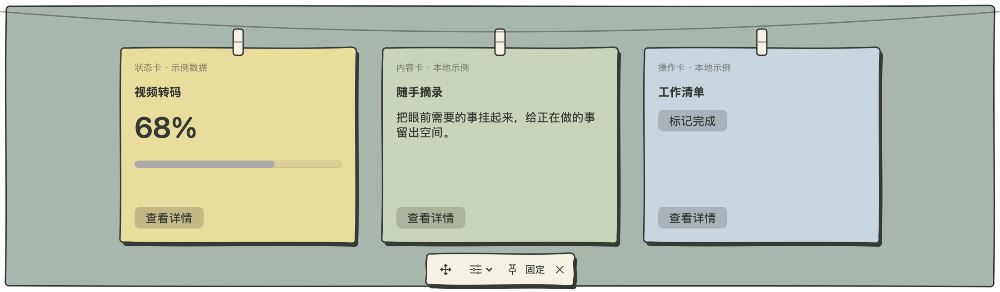

# 可选界面风格

模板提供 `system`（系统材质）和 `looseleaf`（手绘纸张）。手绘样式从灵感晾台 1.4.0 的原生 SwiftUI 实现提取，视觉参考 Looseleaf。只依赖本模板，不需要来源应用的目录、字体、图片、React 或 shadcn/ui。



## 创建与切换

```sh
python3 '<skill-dir>/scripts/scaffold.py' '/absolute/path/NewApp' \
  --name '任务晾台' --bundle-id 'local.example.taskrail' --style looseleaf
```

`--style` 只设定新项目的初始风格。运行时可通过菜单栏「界面风格」，或挂卡工具栏「位置与显示」中的「界面风格」切换。`RailState.style` 将选择保存到调用方 UserDefaults 的 `rail.style`，重启恢复。没有已存选项或值无法识别时使用 `defaultStyle`，默认值为 `.system`。不修改业务数据、挂卡顺序、位置、尺寸或固定状态。

已有工程接入时，将 `RailStyle.swift` 与其余通用源文件一并复制。直接创建状态：

```swift
let state = RailState(defaults: .standard, defaultStyle: .looseleaf)
```

## 纸面与内容

- `RailPaperShape` 使用固定曲线生成略不规则的轮廓。不要在 `body` 或绘制中加入随机数，否则输入、布局或状态刷新时边框会变化。
- `RailPaperSurface` 提供 1.6 点深色描边、向右 3 点／向下 4 点的实色偏移阴影，`colorIndex` 的 0～3 对应黄、绿、蓝、粉，越界索引会限制在有效范围。
- `ClotheslineView` 已注入样式环境；卡片、工具栏、背景与夹子响应风格切换。可通过 `paperColor` 闭包为业务对象选择颜色：

```swift
ClotheslineView(state: state, items: items, title: { $0.title },
                paperColor: { $0.colorIndex }) { item, compact in
    MyCard(item: item, compact: compact)
}
```

`MyCard` 负责内容及交互，外层 `HangingCard` 负责纸面。不要再给内容铺满不透明背景，否则会遮住纸张颜色。`paperColor` 省略时为黄色；系统材质忽略此索引。不要根据排序下标选颜色，避免重新排序后颜色发生变化。

## 独立窗口与外观边界

`RailAppearance(state:windowBackground:)` 观察同一份 `RailState`，供已打开的详情、编辑器等窗口复用。控制器的 `showDetail` 已接入；自建窗口可以使用：

```swift
EditorView(model: model)
    .modifier(RailAppearance(state: state, windowBackground: true))
```

该 modifier 更新环境与背景，不替换内容根节点，也不使用 `.id(style)`。这样风格切换不会因重建根节点而清空 `@State` 或编辑器内容。手绘主题显式采用浅色 SwiftUI 环境，系统材质仍跟随系统。系统标题栏与原生菜单保持 macOS 外观；嵌入的自定义 AppKit 编辑器需要宿主同时更新文字与背景，不能假定 SwiftUI 环境会自动修改其所有属性。

需要给业务按钮添加纸面时，在按钮标签的 padding 后加 `.modifier(RailPaperSurface(fill: RailPaper.sage))`，配合 `.buttonStyle(.plain)`。点击、禁用、焦点和辅助功能语义仍由实际 Button 提供。

## 验证

运行模板测试和打包，再用 `--preview-directory` 生成 32 张预览；文件名包含风格、边缘、尺寸和系统外观。手绘风格的 dark 预览表示“系统处于深色时仍显示浅色纸张”，并非暗色纸张主题。检查四边夹子方向、阴影留白、滚动区域和工具栏。另手动验证菜单切换、编辑中切换与重启恢复，截图不能代替交互验证。
